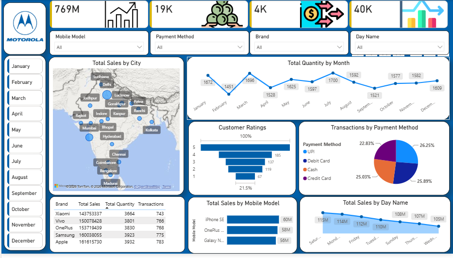

# Mobile Sales Performance Dashboard

## Overview

An interactive Power BI dashboard for exploring mobile sales performance, product trends, city-level sales distribution, customer ratings, and payment methods.

## Dashboard Preview

## Business Objectives

- Analyze sales performance across mobile brands and models.
- Explore city-level sales distribution.
- Track monthly quantity trends.
- Examine customer rating distribution.
- Compare payment methods and product performance.

## Dataset

The source Excel workbook contains 3,835 records and 14 columns.

The dataset includes mobile sales attributes such as brand, mobile model, city, payment method, customer rating, quantity, price, and date-related fields.

**Dataset source:** [Add the original source URL]

> The dataset is not included in this repository until its redistribution permissions have been confirmed.

## Dashboard Features

- Sales KPI cards.
- City-level sales map.
- Monthly quantity trend.
- Customer rating distribution.
- Payment method distribution.
- Brand and mobile model comparisons.
- Filters for mobile model, payment method, brand, day name, and month.

## Technologies

- Microsoft Power BI
- Microsoft Excel

## How to Open the Project

1. Download or clone this repository.
2. Install Microsoft Power BI Desktop.
3. Open `Mobile Sales Dashboard.pbix`.
4. If prompted, update the data source path to your local Excel workbook.
5. Refresh the report and verify the visuals.

## Data Validation

Initial source-data checks identified inconsistent weekday labels, including abbreviated and full weekday names. These should be standardized before final validation.

KPI calculations, geographic accuracy, slicer interactions, and refresh behavior should be tested in Power BI Desktop before relying on the report for business decisions.

## Future Improvements

- Standardize weekday labels and sorting.
- Validate all KPI calculations against the source data.
- Improve tooltips and drill-through analysis.
- Document the data model and calculations.
- Publish a live demo if sharing permissions allow.

## Author

**Avinash Patel**

- GitHub: <https://github.com/AvinashWorks-07>
- LinkedIn: <https://linkedin.com/in/avinash-patel-953b71303>
